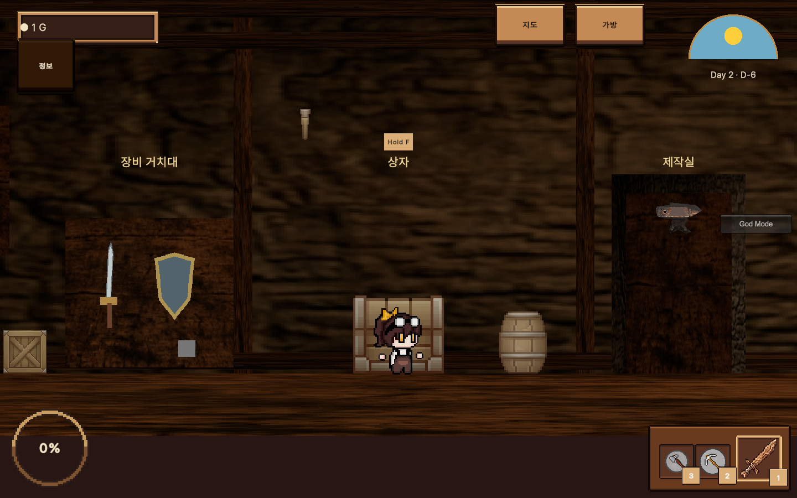
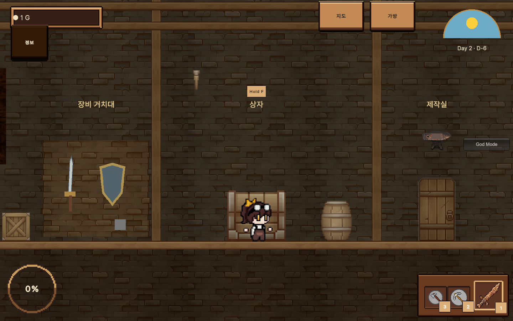

# Map design evidence — 2026-11-01

Original batterMap received two reviewed scene files only. Captures are real isolated Game View at exact displayed resolutions, using prepared positions. Native OS input and exhaustive cave traversal were not performed.

Final interiors use `room-verified`; initial interior images were superseded after pivot/sorting corrections. The original baseline required a QA-only town-controller guard correction after27 captures; raw results are retained.55 paired images have identical recorded camera/zoom;14 differ and are not treated as exact visual comparisons.

| View | Before | Final | Grayscale | Exact recorded camera |
|---|---|---|---|---|
| field-0-1280 | [before](before/field-0-1280.png) | [after](after/field-0-1280.png) | [gray](grayscale/field-0-1280.png) | yes |
| field-0-1440 | [before](before/field-0-1440.png) | [after](after/field-0-1440.png) | [gray](grayscale/field-0-1440.png) | no — runtime camera differs |
| field-0-1920 | [before](before/field-0-1920.png) | [after](after/field-0-1920.png) | [gray](grayscale/field-0-1920.png) | yes |
| field-1-1280 | [before](before/field-1-1280.png) | [after](after/field-1-1280.png) | [gray](grayscale/field-1-1280.png) | yes |
| field-1-1440 | [before](before/field-1-1440.png) | [after](after/field-1-1440.png) | [gray](grayscale/field-1-1440.png) | no — runtime camera differs |
| field-1-1920 | [before](before/field-1-1920.png) | [after](after/field-1-1920.png) | [gray](grayscale/field-1-1920.png) | yes |
| field-10-1280 | [before](before/field-10-1280.png) | [after](after/field-10-1280.png) | [gray](grayscale/field-10-1280.png) | no — runtime camera differs |
| field-10-1440 | [before](before/field-10-1440.png) | [after](after/field-10-1440.png) | [gray](grayscale/field-10-1440.png) | no — runtime camera differs |
| field-10-1920 | [before](before/field-10-1920.png) | [after](after/field-10-1920.png) | [gray](grayscale/field-10-1920.png) | no — runtime camera differs |
| field-11-1280 | [before](before/field-11-1280.png) | [after](after/field-11-1280.png) | [gray](grayscale/field-11-1280.png) | yes |
| field-11-1440 | [before](before/field-11-1440.png) | [after](after/field-11-1440.png) | [gray](grayscale/field-11-1440.png) | yes |
| field-11-1920 | [before](before/field-11-1920.png) | [after](after/field-11-1920.png) | [gray](grayscale/field-11-1920.png) | yes |
| field-2-1280 | [before](before/field-2-1280.png) | [after](after/field-2-1280.png) | [gray](grayscale/field-2-1280.png) | yes |
| field-2-1440 | [before](before/field-2-1440.png) | [after](after/field-2-1440.png) | [gray](grayscale/field-2-1440.png) | no — runtime camera differs |
| field-2-1920 | [before](before/field-2-1920.png) | [after](after/field-2-1920.png) | [gray](grayscale/field-2-1920.png) | yes |
| field-3-1280 | [before](before/field-3-1280.png) | [after](after/field-3-1280.png) | [gray](grayscale/field-3-1280.png) | yes |
| field-3-1440 | [before](before/field-3-1440.png) | [after](after/field-3-1440.png) | [gray](grayscale/field-3-1440.png) | no — runtime camera differs |
| field-3-1920 | [before](before/field-3-1920.png) | [after](after/field-3-1920.png) | [gray](grayscale/field-3-1920.png) | yes |
| field-4-1280 | [before](before/field-4-1280.png) | [after](after/field-4-1280.png) | [gray](grayscale/field-4-1280.png) | yes |
| field-4-1440 | [before](before/field-4-1440.png) | [after](after/field-4-1440.png) | [gray](grayscale/field-4-1440.png) | yes |
| field-4-1920 | [before](before/field-4-1920.png) | [after](after/field-4-1920.png) | [gray](grayscale/field-4-1920.png) | yes |
| field-5-1280 | [before](before/field-5-1280.png) | [after](after/field-5-1280.png) | [gray](grayscale/field-5-1280.png) | yes |
| field-5-1440 | [before](before/field-5-1440.png) | [after](after/field-5-1440.png) | [gray](grayscale/field-5-1440.png) | yes |
| field-5-1920 | [before](before/field-5-1920.png) | [after](after/field-5-1920.png) | [gray](grayscale/field-5-1920.png) | yes |
| field-6-1280 | [before](before/field-6-1280.png) | [after](after/field-6-1280.png) | [gray](grayscale/field-6-1280.png) | yes |
| field-6-1440 | [before](before/field-6-1440.png) | [after](after/field-6-1440.png) | [gray](grayscale/field-6-1440.png) | yes |
| field-6-1920 | [before](before/field-6-1920.png) | [after](after/field-6-1920.png) | [gray](grayscale/field-6-1920.png) | yes |
| field-7-1280 | [before](before/field-7-1280.png) | [after](after/field-7-1280.png) | [gray](grayscale/field-7-1280.png) | yes |
| field-7-1440 | [before](before/field-7-1440.png) | [after](after/field-7-1440.png) | [gray](grayscale/field-7-1440.png) | yes |
| field-7-1920 | [before](before/field-7-1920.png) | [after](after/field-7-1920.png) | [gray](grayscale/field-7-1920.png) | yes |
| field-8-1280 | [before](before/field-8-1280.png) | [after](after/field-8-1280.png) | [gray](grayscale/field-8-1280.png) | yes |
| field-8-1440 | [before](before/field-8-1440.png) | [after](after/field-8-1440.png) | [gray](grayscale/field-8-1440.png) | yes |
| field-8-1920 | [before](before/field-8-1920.png) | [after](after/field-8-1920.png) | [gray](grayscale/field-8-1920.png) | yes |
| field-9-1280 | [before](before/field-9-1280.png) | [after](after/field-9-1280.png) | [gray](grayscale/field-9-1280.png) | no — runtime camera differs |
| field-9-1440 | [before](before/field-9-1440.png) | [after](after/field-9-1440.png) | [gray](grayscale/field-9-1440.png) | no — runtime camera differs |
| field-9-1920 | [before](before/field-9-1920.png) | [after](after/field-9-1920.png) | [gray](grayscale/field-9-1920.png) | no — runtime camera differs |
| interior-0-1280 | [before](before/interior-0-1280.png) | [after](after/interior-0-1280.png) | [gray](grayscale/interior-0-1280.png) | yes |
| interior-0-1440 | [before](before/interior-0-1440.png) | [after](after/interior-0-1440.png) | [gray](grayscale/interior-0-1440.png) | no — runtime camera differs |
| interior-0-1920 | [before](before/interior-0-1920.png) | [after](after/interior-0-1920.png) | [gray](grayscale/interior-0-1920.png) | yes |
| interior-1-1280 | [before](before/interior-1-1280.png) | [after](after/interior-1-1280.png) | [gray](grayscale/interior-1-1280.png) | yes |
| interior-1-1440 | [before](before/interior-1-1440.png) | [after](after/interior-1-1440.png) | [gray](grayscale/interior-1-1440.png) | yes |
| interior-1-1920 | [before](before/interior-1-1920.png) | [after](after/interior-1-1920.png) | [gray](grayscale/interior-1-1920.png) | yes |
| interior-2-1280 | [before](before/interior-2-1280.png) | [after](after/interior-2-1280.png) | [gray](grayscale/interior-2-1280.png) | yes |
| interior-2-1440 | [before](before/interior-2-1440.png) | [after](after/interior-2-1440.png) | [gray](grayscale/interior-2-1440.png) | yes |
| interior-2-1920 | [before](before/interior-2-1920.png) | [after](after/interior-2-1920.png) | [gray](grayscale/interior-2-1920.png) | yes |
| interior-3-1280 | [before](before/interior-3-1280.png) | [after](after/interior-3-1280.png) | [gray](grayscale/interior-3-1280.png) | yes |
| interior-3-1440 | [before](before/interior-3-1440.png) | [after](after/interior-3-1440.png) | [gray](grayscale/interior-3-1440.png) | yes |
| interior-3-1920 | [before](before/interior-3-1920.png) | [after](after/interior-3-1920.png) | [gray](grayscale/interior-3-1920.png) | yes |
| interior-4-1280 | [before](before/interior-4-1280.png) | [after](after/interior-4-1280.png) | [gray](grayscale/interior-4-1280.png) | yes |
| interior-4-1440 | [before](before/interior-4-1440.png) | [after](after/interior-4-1440.png) | [gray](grayscale/interior-4-1440.png) | no — runtime camera differs |
| interior-4-1920 | [before](before/interior-4-1920.png) | [after](after/interior-4-1920.png) | [gray](grayscale/interior-4-1920.png) | yes |
| town-0-1280 | [before](before/town-0-1280.png) | [after](after/town-0-1280.png) | [gray](grayscale/town-0-1280.png) | yes |
| town-0-1440 | [before](before/town-0-1440.png) | [after](after/town-0-1440.png) | [gray](grayscale/town-0-1440.png) | no — runtime camera differs |
| town-0-1920 | [before](before/town-0-1920.png) | [after](after/town-0-1920.png) | [gray](grayscale/town-0-1920.png) | yes |
| town-1-1280 | [before](before/town-1-1280.png) | [after](after/town-1-1280.png) | [gray](grayscale/town-1-1280.png) | yes |
| town-1-1440 | [before](before/town-1-1440.png) | [after](after/town-1-1440.png) | [gray](grayscale/town-1-1440.png) | yes |
| town-1-1920 | [before](before/town-1-1920.png) | [after](after/town-1-1920.png) | [gray](grayscale/town-1-1920.png) | yes |
| town-2-1280 | [before](before/town-2-1280.png) | [after](after/town-2-1280.png) | [gray](grayscale/town-2-1280.png) | yes |
| town-2-1440 | [before](before/town-2-1440.png) | [after](after/town-2-1440.png) | [gray](grayscale/town-2-1440.png) | yes |
| town-2-1920 | [before](before/town-2-1920.png) | [after](after/town-2-1920.png) | [gray](grayscale/town-2-1920.png) | yes |
| town-3-1280 | [before](before/town-3-1280.png) | [after](after/town-3-1280.png) | [gray](grayscale/town-3-1280.png) | yes |
| town-3-1440 | [before](before/town-3-1440.png) | [after](after/town-3-1440.png) | [gray](grayscale/town-3-1440.png) | no — runtime camera differs |
| town-3-1920 | [before](before/town-3-1920.png) | [after](after/town-3-1920.png) | [gray](grayscale/town-3-1920.png) | yes |
| tutorial-0-1280 | [before](before/tutorial-0-1280.png) | [after](after/tutorial-0-1280.png) | [gray](grayscale/tutorial-0-1280.png) | yes |
| tutorial-0-1440 | [before](before/tutorial-0-1440.png) | [after](after/tutorial-0-1440.png) | [gray](grayscale/tutorial-0-1440.png) | yes |
| tutorial-0-1920 | [before](before/tutorial-0-1920.png) | [after](after/tutorial-0-1920.png) | [gray](grayscale/tutorial-0-1920.png) | yes |
| tutorial-1-1280 | [before](before/tutorial-1-1280.png) | [after](after/tutorial-1-1280.png) | [gray](grayscale/tutorial-1-1280.png) | yes |
| tutorial-1-1440 | [before](before/tutorial-1-1440.png) | [after](after/tutorial-1-1440.png) | [gray](grayscale/tutorial-1-1440.png) | yes |
| tutorial-1-1920 | [before](before/tutorial-1-1920.png) | [after](after/tutorial-1-1920.png) | [gray](grayscale/tutorial-1-1920.png) | yes |

## Representative room comparison

## Verification limits

Prepared state: field approaches, unlocked warp, tutorial altar checkpoint. Actual service/callback path: harvest/drop/pickup, marker confirmation, offering close, station opening and fresh continue. Synthetic InputSystem: movement/jump/S/F. No claim of native pointer/keyboard, complete tutorial1–13, all cave routes/AI or Windows verification.
